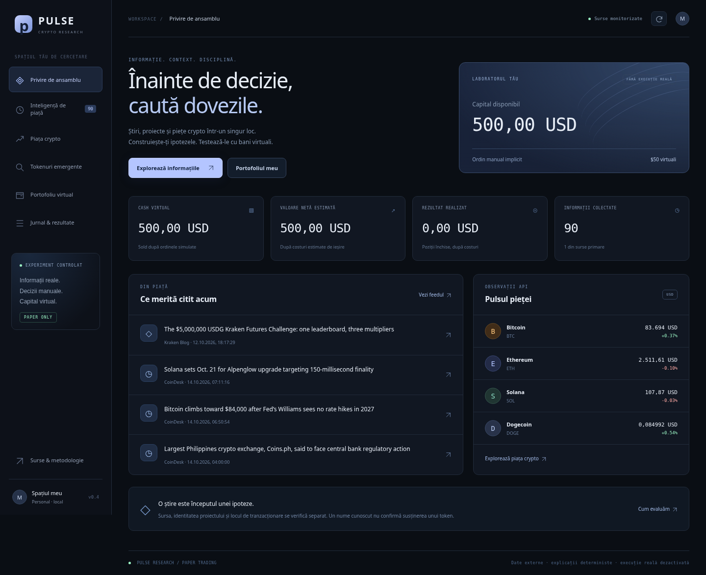

# PULSE — Crypto Research v0.6

Terminal personal pentru știri crypto, cercetare de proiecte și un portofoliu virtual. Interfață
în română, navigare desktop/mobil și ordine manuale de $50. Nicio tranzacție reală.

Versiunea 0.6 repară sursele și deduplicarea, adaugă discovery Solana/Base, observații on-chain,
wallet activity, alerte în aplicație, cotații Jupiter pentru paper și autentificare pentru găzduire.
[Auditul complet și starea fiecărei funcții](docs/V0.6-AUDIT.md) separă verificările reale de mock-uri
și precizează ce necesită chei sau date suplimentare. Modelul local testat a produs și erori;
nu considerăm semnalele validate sau profitabile. AI rămâne opțional, oprit implicit.
Funcțiile anterioare de dosare, watchlist, portofoliu, export și backup sunt păstrate.



## Cum îl deschizi pe Windows

Din [repository](https://github.com/Serin15/chatgpt), **Code → Download ZIP**, apoi **Extrage tot**.
În folderul `chatgpt-main`, dublu clic pe `start-windows.cmd`. Necesită Python/Python Launcher
sau `uv`; vezi [DESCHIDE-APLICATIA.md](DESCHIDE-APLICATIA.md). La prima pornire se instalează
dependențele, apoi browserul se deschide automat. Păstrează fereastra de comandă deschisă.

Pentru actualizare, oprește aplicația, fă backup directorului `data`, apoi copiază fișierele noi
peste folderul folosit anterior, păstrând `data`. Dacă pornești dintr-un folder nou, contul virtual
va fi nou. Nu șterge istoricul pentru a rezolva o problemă de instalare.

## Fluxul tău

1. **Inteligență de piață**: știri generale, lansări, listări și persoane publice. Surse primare
   Ethereum Foundation/Kraken, CoinDesk și căutări Google News pentru crypto, Trump, Musk,
   Zelenski și Claude/Anthropic. Titluri „100x”/„price prediction” și știri politice fără context
   crypto în feedul persoanelor publice sunt filtrate. Actualizare la 5 minute când serverul rulează.
2. **Piața crypto**: până la 25 de active per actualizare CoinGecko, cu păstrarea observațiilor anterioare. Prețuri, volume, capitalizare
   și dosare cu întrebările de verificat. Linkuri de proiect/whitepaper/repository pot fi cerute
   din metadata CoinGecko; sunt declarații ale furnizorului, nu o evaluare independentă.
3. **Unde există tranzacționare?**: perechi și linkuri reportate de CoinGecko; ticker-ele marcate
   stale/anomalous sunt omise. Pentru Solana, pool și mint prin DEX Screener/explorer. Nu presupunem
   acces la presale sau înaintea unei viitoare listări CEX.
4. **Paper trading**: contul Research păstrează vechiul cont de știri în
   `data/news_paper/research.sqlite3`, inițial $500 fictivi. Suma implicită este $50. Salvezi
   informația/ipoteza, aștepți minimum 3 secunde, apoi apeși manual **Simulează intrarea**.
5. **Portofoliu / jurnal**: cantitate, cost, estimare netă de ieșire, rezultat realizat și motivele
   inițiale. Articolul și ipoteza capturate la intrare nu sunt rescrise de feedul ulterior.
6. **Dosar cu dovezi**: sursă, citat, emitent, data publicării, chain/contract și motivul evaluării
   pentru identitate, anunț, produs, echipă, tokenomics, audit și lichiditate. Evaluările sunt
   manuale; un citat găsit într-un document nu confirmă adevărul sau afilierea tokenului.
7. **Măsurarea experimentului**: rezultat realizat, randament/equity estimat, win rate numai din
   poziții închise, încercări respinse, drawdown observat și comparație BTC pe perioade aliniate.
   Exportul JSON păstrează întregul experiment; backupul ZIP include ambele baze SQLite.
8. **Anunț și contract**: în dosar poți compara adresa exactă și chain-ul cu pagina originală.
   Potrivirea tehnică este separată de evaluarea manuală a relației emitentului/pieței cu moneda.
   O redacție nu poate fi aprobată ca emitent. Dovezile, data și amprenta documentului sunt păstrate.
9. **Interpretare AI cu citări**: configurezi un motor, alegi documentul și pornești analiza manual.
   Rezumat, relație ipotetică, întrebări și riscuri în română. Citatele trebuie să existe în text;
   aceasta nu verifică adevărul sau sensul lor. Analiza intră în copia semnalului paper.

Sursa primară și o redacție cunoscută primesc prioritate de afișare. Aceasta nu verifică afirmația,
nu confirmă susținerea unui token și nu măsoară probabilitatea de profit. Numele este uneori doar
un indiciu de cercetare; afilierea oficială și cauzalitatea știre–token rămân neconfirmate.

## Simularea crypto generale

Pentru unele active (BTC, ETH, SOL etc.), la semnal/intrare/ieșire cerem order book public Coinbase
L1: cumpărare la ask, vânzare la bid și respingere dacă ordinul depășește cantitatea observată.
Fee-ul presupus este configurabil, implicit 0,6% pe sens; nu este fee-ul unui cont Coinbase.
Când book-ul nu este disponibil, un **nou** experiment poate folosi preț CoinGecko, fee presupus
și slippage de scenariu (0,5%). Modelul și lipsa verificării execuției sunt salvate în fiecare ordin.

O poziție intrată pe modelul cu order book necesită un book nou pentru ieșire; nu înlocuim
lichiditatea lipsă cu un fill la preț de referință. În fundal se actualizează până la 7 active deținute
sau urmărite, prin rotație, pe ciclu; după ciclu se așteaptă 60s. Catalogul de 25 de active se cere
la aproximativ 2 minute. Căutarea permite adăugarea a maximum 20 de active în watchlist crypto.
Prețurile expirate sunt marcate; la ordin se cer date noi. O estimare nevalidabilă rămâne necunoscută.

Prețurile și book-urile sunt observații, nu ordine garantate. Nu avem latență zero, fee real per cont,
minimum-order validation complet sau model pentru eșecuri on-chain. DEX rămâne simularea aproximativă
de pool descrisă mai jos. Toate fill-urile au `execution_verified=false`.

## Ce rămâne de demonstrat

Aplicația nu validează încă automat produsul, echipa, tokenomics/vesting sau auditurile și nu poate
numi un proiect „solid” fără acele dovezi. Nu detectează toate lansările de pe toate chain-urile.
Endpointul CoinGecko de coins recent adăugate cere Analyst sau un plan superior; nu am introdus
un abonament plătit. Știrile de lansare și discovery-ul Solana sunt acoperire parțială.

Avantajul financiar rămâne de măsurat pe informații înregistrate înainte de intrare, cu costuri,
întârzieri și ieșiri eșuate. Testele verifică funcționarea și calculele, nu profitabilitatea.
Validarea semantică independentă, evaluarea unui model real, datele istorice de wallets, Base
on-chain și alertele externe sunt etape ulterioare. Știrile/piața se actualizează automat cât timp
serverul rulează; analiza AI pornește manual și codul nu se modifică singur. Un contract găsit
în pagină nu demonstrează singur afilierea, susținerea unei persoane sau legitimitatea proiectului.

## Pornire

Necesită Python 3.12+ și `uv` (deja disponibile în mediul cloud).

```bash
cd /workspace/chatgpt
export UV_CACHE_DIR=/workspace/.cache/uv
uv sync --frozen
.venv/bin/uvicorn app.main:app --host 127.0.0.1 --port 8000
```

Serverul servește dashboardul la ruta `/` și API-ul la `/api/*`. Portul implicit este 8000.
Este destinat rulării locale personale; păstrează bind-ul pe loopback. Expunerea publică necesită
autentificare, HTTPS și alte controale într-o etapă separată.

Nu sunt necesare chei API pentru sursele publice existente sau Ollama local. OpenAI API este opțional
și necesită cheia și creditul propriu; nu a fost testat live în lipsa lor.
Nu introduce private keys sau seed phrases. Variabilele opționale sunt în `.env.example`;
fișierul `.env` nu se încarcă automat. Exportă numai variabilele necesare în shell.
`SOLANA_RPC_URL` poate înlocui RPC-ul public cu un furnizor ales ulterior; folosește HTTPS.

`data/research.sqlite3` păstrează observațiile, semnalele, ordinele și soldul fictiv.
Nu se resetează la restart. `PAPER_START_USD=50` stabilește capitalul numai pentru o bază nouă;
pentru un experiment separat, folosește un alt `DATA_DIR`, fără ștergerea istoricului existent.
Oprește serverul înainte de backup și păstrează întregul director `data`, inclusiv fișierele WAL.
Butonul **Backup complet** din jurnal poate crea un backup consistent și cu aplicația pornită.
Pentru restaurare, oprește aplicația, păstrează o copie a datelor curente și extrage cele două baze
din ZIP în `data`, respectând subdirectorul `news_paper`. Restaurarea se face într-un director gol
de date, fără fișiere WAL/SHM vechi. Exportul JSON este pentru analiză, nu pentru restaurare.

## Ce funcționează

- Discovery periodic din cele mai recente profiluri Solana DEX Screener; maximum 12 profiluri
  per ciclu. Sunt monitorizate maximum 30 de adrese per ciclu, cu prioritate pentru poziții și
  watchlist; maximum 20 de tokenuri în watchlist. Ciclul următor începe la 90s după încheierea
  precedentului. Aceasta este polling, nu un flux websocket.
- Adăugare manuală a unui mint valid, selecția poolului cu cea mai mare lichiditate raportată
  unde mintul este tokenul de bază, preț, volum, tranzacții buy/sell și vechimea poolului.
- RPC `getAccountInfo` verifică autoritățile mint/freeze. GoPlus furnizează avertismente terțe.
  Sunt acceptate SPL clasic și Token-2022 cu o listă de extensii complet interpretată și limitată
  la `metadataPointer`/`tokenMetadata`. Alte extensii/programe blochează paper trading.
- Veto pentru autorități active, restricții cunoscute, taxe de transfer nesimulate și lichiditate
  sub prag. Datele lipsă sunt necunoscute, nu rapoarte „clean”. Risc securitate `null` după trecerea
  verificărilor de bază înseamnă că riscul total nu a fost cuantificat.
- Istoric, dosar token, scoruri, surse/erori și timestamp-uri. La afișare și la simulare sunt
  reverificate condițiile de prospețime.
- Semnale salvate înainte de intrare. Fill-ul folosește o observație nouă după semnal, minimum
  3 secunde întârziere, maximum 120 secunde vechime. Dacă refresh-ul eșuează nu se folosește cache
  pentru a înregistra un fill.
- Calcule financiare cu `Decimal`, debit/credit atomic în SQLite și protecție contra reutilizării
  semnalului. Jurnalul include dovezi, costuri, impact, prag orientativ de break-even și respingeri.

Discovery este un eșantion de profiluri, nu toate lansările, toate memecoinurile sau participanți
unici. Profilurile/atenția pot fi cumpărate. Tokenurile fără preț/lichiditate raportată rămân fără
snapshot, cu eroarea explicită. RPC-ul și rapoartele de securitate sunt read-only.

## Reguli și scoruri

Parametrii pot fi configurați prin variabilele din `.env.example`. Setările implicit folosite:

| Regulă | Valoare |
| --- | --- |
| Capital fictiv inițial Scanner / Research | $100 / $500 |
| Alocare maximă per poziție, inclusiv costuri | 20% din capitalul conservator |
| Expunere totală la cost | 50% din capitalul conservator |
| Capital conservator | min(capital inițial, cash + costul pozițiilor deschise) |
| Pierderi realizate zilnice | 10% din capitalul inițial, zi UTC; câștigurile nu șterg pierderile |
| Lichiditate minimă raportată | $25.000 |
| Impact estimat maxim | 2% |
| Poziție minimă | $2 |
| Comision swap presupus | 0,3% pe sens |
| Cost rețea presupus | $0,01 pe sens |

Activitate = min(60, volum 5m / lichiditate × 300) + min(40, număr tranzacții 5m / 2).
Momentum = clamp(50 + variație procentuală 5m × 2, 0, 100).
Lichiditate/ieșire = min(100, lichiditate / prag × 50).
Prioritate research = 60% activitate + 20% momentum + 20% lichiditate/ieșire, sau 0 când
filtrul paper nu este trecut. Lipsa datelor de activitate/momentum produce `null`; la prioritate
componenta lipsă contribuie 0, fără a inventa o măsurătoare.
Completitudinea verificărilor MVP = 30 pentru preț/lichiditate + 20 pentru toate ferestrele de
piață folosite + 25 pentru verificările RPC suportate + 25 pentru câmpurile GoPlus de bază.
Acest 100/100 nu înseamnă că avem toate datele necesare pentru trading.

`reject` înseamnă veto, `monitor` dovezi incomplete/activitate mică, `investigate` prioritate de
cercetare cu verificările MVP trecute. Niciuna nu reprezintă recomandare de cumpărare sau probabilitate.

## Limite ale paper tradingului

Pentru DEX, modelul presupune un pool constant-product cu jumătate din lichiditatea USD pe fiecare latură.
Acest lucru nu descrie corect poolurile cu lichiditate concentrată, bonding curves sau rutarea
multi-hop. Costurile nu provin dintr-o cotație Jupiter și nu includ ATA rent, prioritate variabilă,
MEV, schimbarea prețului între cotație și execuție sau costurile tranzacțiilor eșuate on-chain.
Impactul estimat nu este o limită garantată de slippage. Toate fill-urile au `execution_verified=false`.

Eșecurile înregistrate acum sunt respingeri înainte de execuția ipotetică, fără debit de fee.
Nu inventăm probabilități de eșec. O ieșire nevalidabilă nu închide poziția și nu creditează soldul;
pozițiile neieșite nu sunt prezentate ca pierderi realizate. Equity-ul estimat rămâne necunoscut
dacă o ieșire nu poate fi evaluată. Drawdown-ul folosește numai observațiile colectate din v0.3,
cu golurile raportate; nu reconstruiește un istoric anterior și poate rata mișcări între observații.
Pragul break-even este valabil numai în același model, cu lichiditate constantă și fee-urile presupuse.

Nu sunt încă verificate concentrarea pe proprietari, istoricul deployerului, LP locks/withdrawals,
wash trading, conturi individuale înghețate sau posibilitatea unui swap real. Un mint fără freeze
authority poate avea conturi înghețate anterior. Nu există stop-loss automat sau garanție de ieșire.

## Verificare

```bash
cd /workspace/chatgpt
.venv/bin/pytest -q
.venv/bin/ruff check app tests
node --check app/static/app.js
.venv/bin/python -m app.smoke
```

Verificări UI izolate: `UV_CACHE_DIR=/workspace/.cache/uv uv run --with playwright python tests/browser_smoke.py`
și aceeași comandă cu `tests/browser_regressions.py`; necesită Chromium la `/usr/bin/chromium`.
Fluxurile noi se verifică prin aceeași comandă cu `tests/browser_announcements.py` și
`tests/browser_ai.py` (documente și motor AI simulate). Setul de evaluare AI se validează offline
cu `uv run python -m app.ai_evaluation`; aceasta nu măsoară precizia unui model.
Nu rulează nativ launcherul Windows. [Validarea](docs/VALIDATION.md) separă testele simulate de
probele cu surse reale.

`pytest` folosește răspunsuri simulate și baze temporare. `app.smoke` contactează API-urile reale;
folosește wrapped SOL pentru infrastructura Solana, BTC pentru preț/order book și CoinDesk pentru
metadata de știri, fără ordine. Observațiile de piață pot fi actualizate; soldul nu se modifică. Testul live eșuează cu exit nonzero dacă probele obligatorii eșuează.

Test opțional în browser, cu Chromium instalat:

```bash
UV_CACHE_DIR=/workspace/.cache/uv uv run --with playwright python tests/browser_smoke.py
```

Browser test pornește un server fixture separat și o bază temporară; nu scrie date fictive în
aplicația reală. Verifică scanare, semnal, întârziere, intrare, ieșire, jurnal și layout mobil.

Sursele, costurile și observațiile de validare sunt în [docs/SOURCES.md](docs/SOURCES.md).
Etapele următoare și criteriile de acceptare sunt în [docs/ROADMAP.md](docs/ROADMAP.md).

Auditul codului v0.2, bugurile reproduse și prioritățile pentru următorul milestone sunt în
[docs/AUDIT-2026-10-13.md](docs/AUDIT-2026-10-13.md). Raportul și probele nu remediază încă bugurile.
